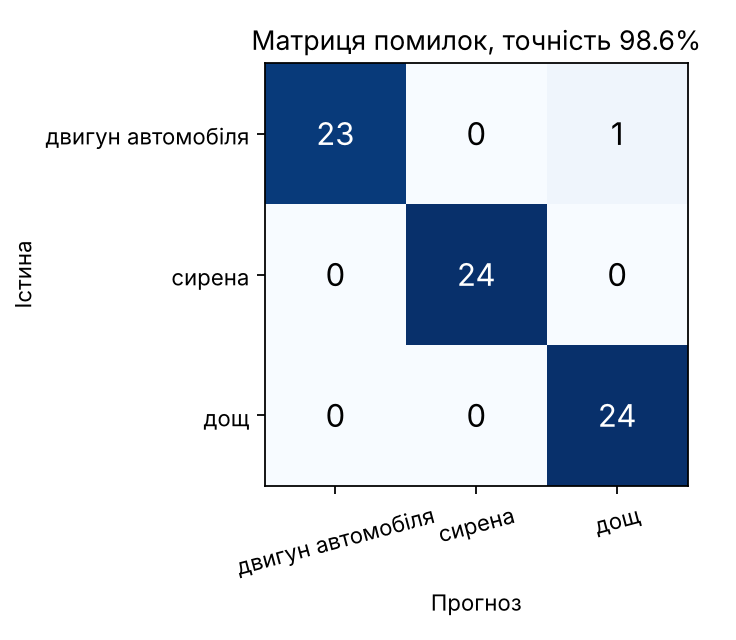

# Розпізнавання звуків навколишнього середовища: двигун / сирена / дощ

Навчальний мініпроєкт (НУОУ, дисципліна «Методологія ІАЗ в системі ОВУ», тема 4, заняття 13, варіант 3).
Готова аудіомодель **YAMNet** використовується як екстрактор ознак, поверх неї навчено новий класифікатор на три класи.

## Модель
| | |
|---|---|
| Назва | YAMNet (Google) — CNN MobileNet v1, навчена на AudioSet, 521 клас звуків |
| Джерело | TensorFlow Hub: `https://tfhub.dev/google/yamnet/1` (тепер на Kaggle Models), ліцензія Apache 2.0 |
| Локальна копія | `models/yamnet.tflite` — та сама модель TF Hub у форматі TFLite (з репозиторію [tensorflow/tflite-support](https://github.com/tensorflow/tflite-support)), щоб проєкт працював офлайн |
| Вхід / вихід | моно 16 кГц → для кожного кадру 0,96 с (крок 0,48 с): 521 оцінка класів AudioSet + **ембеддинг 1024** |

## Дані
Відкритий набір **ESC-50** (K. J. Piczak, 2015; CC BY-NC 3.0; [github.com/karolpiczak/ESC-50](https://github.com/karolpiczak/ESC-50)): записи по 5 с, 44,1 кГц.
Відібрано класи `engine`, `siren`, `rain` і передискретизовано до 16 кГц:

| Вибірка | Фолди ESC-50 | Записів на клас | Всього |
|---|---|---|---|
| Навчання (`data/train`) | 1–2 | 15 | 45 записів → 438 кадрів-ознак |
| Перевірка (`data/test`) | 3–5 (інші джерела запису) | 24 | 72 |
| Сторонні звуки (`data/ood`) | 3–5 | гелікоптер, гроза, потяг, краплі | 8 |

## Що адаптовано
1. Ваги YAMNet **заморожені** — використовується лише її ембеддинг (1024 ознаки на кадр).
2. Замість 521-класового виходу AudioSet навчено нову «голову»: `Dense(256, ReLU) → Dropout(0.3) → Dense(3, softmax)`, 40 епох, Adam.
3. Тихі кадри (паузи в записах ESC-50) відкидаються за порогом RMS.
4. Прогноз для файлу — середнє ймовірностей за всіма кадрами; якщо впевненість < 70 % — позначка «низька впевненість».

## Результати (72 нові записи)
| Метод | Точність |
|---|---|
| YAMNet «як є» (zero-shot через класи AudioSet Engine/Siren/Rain) | 93,1 % |
| **YAMNet + новий класифікатор** | **98,6 %** (71 з 72) |



**Типові помилки**
- `4-171652-A-44` (двигун → «дощ», 87 %): двигун з високим «пиляючим» тембром (YAMNet: *Chainsaw*); широкосмуговий шум схожий на дощ, а таких двигунів серед 15 навчальних записів не було.
- `3-140774-A-10` (дощ, правильно, але 52 %): у записі чути транспорт (YAMNet: *Vehicle*) — змішані звуки.
- **Сторонні звуки:** гелікоптер → «двигун автомобіля» з упевненістю 98–100 %; краплі води → «двигун» 96 %. Класифікатор із закритим набором класів не вміє відповісти «не знаю»; поріг впевненості відсікає лише частину таких випадків (гроза, потяг).

## Запуск
Репозиторій: https://github.com/Oigen5102/MIAZ_2026_work/tree/main/Theme_4/PR_4.13 — команди виконувати з цієї папки.

```bash
pip install -r requirements.txt
python src/train.py                         # витяг ознак, навчання, оцінка -> results/
python src/predict.py demo/*.wav            # аудіофайл -> клас і впевненість
python app.py                               # веб-застосунок http://127.0.0.1:7860
```
`--backend hub` у `train.py`/`predict.py` завантажує оригінальну YAMNet з TF Hub (потрібен Інтернет).
Ноутбук `demo.ipynb` — те саме покроково (працює в Jupyter і Google Colab).
Підготовка даних з нуля: `git clone --depth 1 https://github.com/karolpiczak/ESC-50 && python src/prepare_data.py --esc50 ESC-50`.

## Структура
```
src/common.py        завантаження аудіо, обгортка YAMNet (hub / tflite)
src/prepare_data.py  відбір записів з ESC-50
src/train.py         ознаки YAMNet + навчання класифікатора + оцінка
src/predict.py       інференс з консолі
app.py               веб-інтерфейс (Gradio)
models/              yamnet.tflite, мапа класів AudioSet, навчена голова sound_head.keras
data/                навчальні, тестові та сторонні записи (16 кГц)
demo/                7 прикладів для демонстрації
results/             метрики, прогнози, графіки
```

## Висновок
**Переваги повторного використання:** YAMNet уже «знає» звуки з 2 млн записів AudioSet, тому 15 записів на клас і ~15 с на CPU (ознаки + навчання) достатньо для 98,6 % точності; без GPU, без підбору архітектури. Донавчений класифікатор кращий за YAMNet «як є» (93,1 %), бо та плутає дощ і сирену з «Vehicle».
**Обмеження:** закритий набір класів (сторонній звук завжди віднесено до одного з трьох); мала і однорідна вибірка (ESC-50 — чисті 5-секундні записи, реальні умови шумніші); змішані звуки (дощ + транспорт) знижують впевненість; ліцензія даних CC BY-NC — лише некомерційне використання.
**Оцінка якості:** точність, precision/recall і матриця помилок на 72 записах з інших фолдів ESC-50 (інші джерела запису, без перетину з навчанням) + порівняння з базовим zero-shot варіантом.
**Що покращити:** клас «інше/фон», більше різнотипних записів, аугментація (шум, зміна гучності), калібрування порогу впевненості.

Дані відкриті; інформації з обмеженим доступом проєкт не містить.
